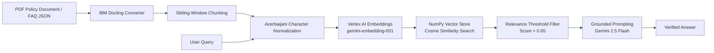

# Bilingual Enterprise RAG Assistant

A retrieval-augmented generation (RAG) assistant designed for corporate internal policies and HR documentation, supporting Azerbaijani and Russian queries.

The pipeline combines document conversion via IBM Docling, dialect-specific character normalization, dense vector retrieval on Google Cloud Vertex AI, and grounded response generation via Gemini 2.5 Flash.

---

## Architecture Overview



---

## Key Features

1. **Layout-Aware PDF Extraction**: Employs IBM Docling instead of naive text extraction to preserve tables, section headers, and hierarchical document flow from corporate policy PDFs.
2. **Azerbaijani Character Normalization**: Specific Latin glyphs (`ə`, `ç`, `ğ`, `ı`, `ö`, `ş`, `ü`) frequently introduce embedding drift across multilingual tokenizers. A normalization layer maps these characters to base Latin forms before vector generation, improving retrieval recall on regional text.
3. **Strict Grounding & Rejection**: Implements a cosine similarity threshold (`> 0.65`) and constrained prompting to reject out-of-domain queries rather than generating hallucinated corporate policies.

---

## Tech Stack

- **Cloud Platform**: Google Cloud Vertex AI (`gemini-embedding-001`, `gemini-2.5-flash`)
- **Document Processing**: IBM Docling (`DocumentConverter`)
- **Vector Search**: NumPy (normalized dot-product cosine similarity)
- **Language**: Python 3.10+

---

## Quickstart

### 1. Installation

```bash
python -m venv venv
source venv/bin/activate  # On Windows: .\venv\Scripts\activate
pip install -r requirements.txt
```

### 2. Configuration

Copy `.env.example` to `.env` and set your Google Cloud project details:

```bash
cp .env.example .env
```

Ensure your Google Cloud credentials are configured via Application Default Credentials (ADC):

```bash
gcloud auth application-default login
```

### 3. Usage

Run the interactive CLI:

```bash
python rag_bot.py
```

Choose from the available knowledge sources:
- `1`: Full PDF policy ingestion (`Document/Daxili_Reglament_FAQ.pdf`)
- `2`: Azerbaijani FAQ dataset (`questaz.json`)
- `3`: Russian FAQ dataset (`quest.json`)
